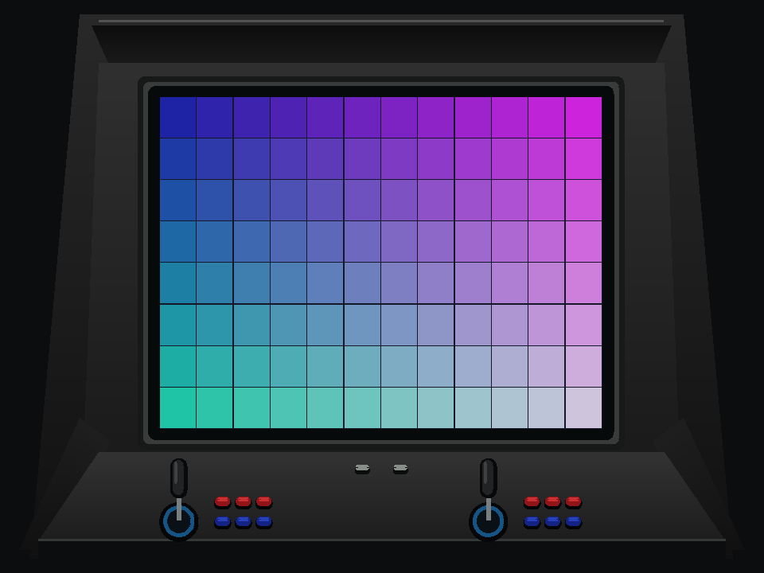

# SFZ2AL Windows — experimental

Adaptação para Windows de Street Fighter Zero 2 Alpha (Asia 960826 e Brazil 960813), baseada no
[CPS-2 Recomp](https://github.com/tmcleroy/cps2recomp). Este repositório contém
código-fonte e ajustes; o usuário fornece seu próprio conjunto sfz2al.zip ou sfz2alb.zip completo.

## Recursos

- Iniciador em português, seletor Brasil / Ásia, seleção do ZIP e modos Jogar/Treino.
- Visual de seleção de luta, painel VS, sons originais de interface, volume e opção de silenciar.
- Painel de prévias animadas locais, com escolha aleatória e pausa.
- Configuração de teclado e gamepad para dois jogadores, incluindo 3 socos e
  3 chutes em um botão.
- Temas Imagem limpa, Fliperama, TV de tubo e Gabinete clássico.
- Brilho e contraste ajustáveis com o jogo aberto, com restauração dos padrões.
- F8 alterna os temas da sessão quando não está atribuído a uma ação; F11 troca
  para tela cheia.



## Conteúdo e limites

Não há ROMs, chaves, programa traduzido, imagens ou áudio do jogo, nem binários.
O nome de uma chave em game.cfg é apenas um identificador com checksum.
Os endereços de entrada são metadados de cobertura, sem instruções.

A tradução 68000/Z80 é produzida localmente a partir da ROM fornecida. Caminhos
ainda não traduzidos podem usar o interpretador. Não é uma reimplementação
independente de toda a lógica do jogo, nem há certificação de fidelidade total.
O treino básico não impede um nocaute. O analógico esquerdo mantém o movimento;
os controles são atribuídos pela ordem em que o jogo os reconhece. Ainda faltam
validação ampla de controles físicos, variantes, todos os finais e áudio.

## Compilação local

### ROMs compatíveis e onde colocá-las

| Opção no app | Conjunto | Revisão | Chave dentro do ZIP |
|---|---|---|---|
| Ásia | sfz2al.zip | Asia 960826 | sfz2al.key — 20 bytes, CRC32 2904963e |
| Brasil | sfz2alb.zip | Brazil 960813 | sfz2alb.key — 20 bytes, CRC32 c8b3ac73 |

Use um ZIP completo por edição: seis ROMs de programa, oito de gráficos, duas
de programa de áudio, duas de amostras e a chave regional. Os nomes e CRC32 de
cada entrada estão em profiles/sfz2al/game.cfg e profiles/sfz2alb/game.cfg.
Não basta renomear outro ZIP: sfa2, outras regiões, revisões modificadas e
conjuntos descriptografados/Phoenix não são os alvos desses perfis.
O critério de compatibilidade é o conteúdo e seus checksums, não apenas a versão
do MAME usada para catalogá-lo. Um clone split só com as diferenças não é o
ZIP completo recomendado aqui. Não é necessário ter as duas edições: compile
e selecione a que você possui; para alternar entre ambas, compile ambas.

Depois da compilação, a organização recomendada, relativa à pasta do app, é:

```text
dist/
  SFZ2AL.exe
  sfz2al-game.exe       (gerado localmente para Ásia)
  sfz2alb-game.exe      (gerado localmente para Brasil)
  user/
    roms/
      sfz2al.zip
      sfz2alb.zip
```

Crie user/roms e mantenha os ZIPs compactados. No app, selecione a edição e use
Escolher ZIP para indicar o arquivo correspondente; ele lembra os caminhos.
Outras pastas também são aceitas. Quando ainda não há caminho salvo, o app procura
as duas edições em user/roms. Caminhos relativos no launcher.ini são resolvidos
a partir da pasta do app, permitindo mudar a instalação de lugar.
O iniciador lê ZIP, não 7z ou RAR.

Essa estrutura é para a instalação local, não para o conteúdo do GitHub.
O repositório contém fontes e instruções de compilação; cada usuário fornece
suas ROMs e gera os executáveis do jogo localmente. Não envie ROMs, chaves,
prévias de gameplay, código traduzido ou a pasta dist para o GitHub.

### Dependências e comandos

Requer Windows x64, Git, Python 3, CMake 3.28 ou superior, Ninja e MSVC com Windows
SDK. Use um Developer PowerShell do Visual Studio. Também são necessários:

- SDL 3.4.16, pacote de desenvolvimento Visual C++ x64:
  https://github.com/libsdl-org/SDL/releases/tag/release-3.4.16
- Fonte da zlib 1.3.1: https://github.com/madler/zlib/tree/v1.3.1
- Seu conjunto sfz2al.zip, identificado pelo perfil Asia 960826.
- Opcional: sfz2alb.zip completo, Brazil 960813, incluindo sfz2alb.key.

Na raiz deste repositório:

    ./scripts/bootstrap.ps1
    ./scripts/build.ps1 -Rom "D:/Jogos/sfz2al.zip" -SdlDir "D:/deps/SDL3-3.4.16" -ZlibSource "D:/deps/zlib"

Para compilar também Brasil, execute build.ps1 novamente com `-Game sfz2alb`
e o caminho do ZIP brasileiro. As duas compilações ficam separadas e o iniciador
usa sfz2al-game.exe ou sfz2alb-game.exe conforme o seletor. No app, cada edição
lembra seu ZIP e usa sua própria EEPROM; os controles e ajustes visuais são
compartilhados. Um pacote 7z precisa ser convertido localmente para ZIP antes;
o iniciador não lê 7z diretamente.

Bootstrap baixa apenas o toolkit na revisão fixada e aplica o patch. Não baixa
o jogo e não modifica um checkout que já exista. Build compila primeiro um
preparador com interpretador, gera o código local, recompila com a tradução
nativa e executa os testes de controles e apresentação. O uso do interpretador
nessa preparação não é apresentado como tradução nativa concluída.

O resultado fica em dist/. Abra SFZ2AL.exe e selecione seu ZIP; não há caminho de
ROM pessoal embutido. As configurações são guardadas junto ao executável.
SFZ2AL.exe tem um ícone original com Z2 dourado para identificar o iniciador.
Não publique work/ ou dist/: eles contêm código produzido a partir do jogo.
Não há release binária neste repositório.

## Prévias animadas locais

O player usa GDI+ do Windows para reproduzir clipes GIF animados, sem áudio,
em dist/user/previews. O primeiro clipe é sorteado e os seguintes também,
evitando repetir imediatamente o mesmo quando há mais de um. Sem clipes,
o painel VS continua disponível. Iniciar o jogo pausa a prévia.
As prévias Brasil ficam em dist/user/previews-brasil. Para gerá-las, informe
`--game dist/sfz2alb-game.exe --out dist/user/previews-brasil` e o ZIP Brasil
ao script build_previews.py. A troca de edição também troca as prévias.

Brilho e contraste atualizam a prévia imediatamente, mesmo pausada, usando a
mesma transformação de cores do jogo. Restaurar imagem recupera as cores originais;
as cores da moldura e dos textos não mudam.

Os clipes não são distribuídos. Para gerá-los da sua ROM, instale Pillow no
Python usado localmente e execute após a compilação:

    python scripts/build_previews.py --rom "D:/Jogos/sfz2al.zip"

Os arquivos em profiles/previews são sequências de botões e números de quadro,
sem imagens, áudio ou código do jogo. Os replays foram conferidos com uma
EEPROM inicializada: se a configuração da sua placa for diferente, forneça uma
cópia local compatível por --seed-eeprom. Esse arquivo também não é distribuído.

O script cria quatro clipes de aproximadamente seis segundos, com imagem
320x240 em proporção 4:3, e valida que possuem vários quadros. GIF foi escolhido
para a prévia não exigir codecs de vídeo adicionais. Não inclua esses arquivos
gerados em commits ou no pacote de fontes.

## Testes sem ROM

Depois de bootstrap, com o SDK SDL disponível:

    cmake -S . -B build -G Ninja -DCMAKE_BUILD_TYPE=Release -DSDL3_DIR="D:/deps/SDL3-3.4.16/cmake"
    cmake --build build
    Copy-Item "D:/deps/SDL3-3.4.16/lib/x64/SDL3.dll" build/
    ctest --test-dir build --output-on-failure

Os quatro testes verificam animação da prévia, síntese dos sons, configuração e salvamento dos dois jogadores, ações
simultâneas, recuperação de falhas, molduras e transformação de cores. Eles
não substituem validação de uma partida completa.

## Licença

Os resultados do ensaio de compilação e seus limites estão em
[docs/VALIDATION.md](docs/VALIDATION.md).

GPL-3.0-only para os fontes e ajustes deste projeto. Veja [LICENSE](LICENSE),
[NOTICE.md](NOTICE.md) e [UPSTREAM_NOTICES.md](UPSTREAM_NOTICES.md).
